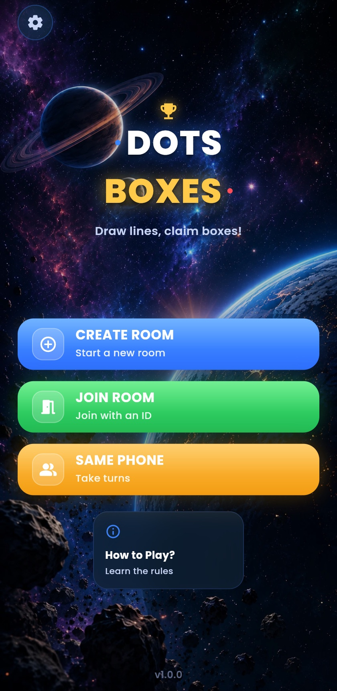
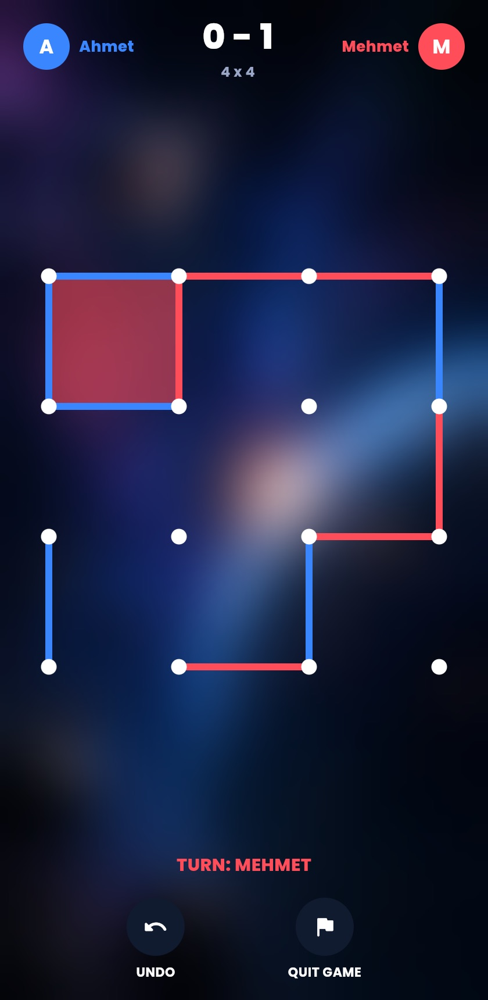
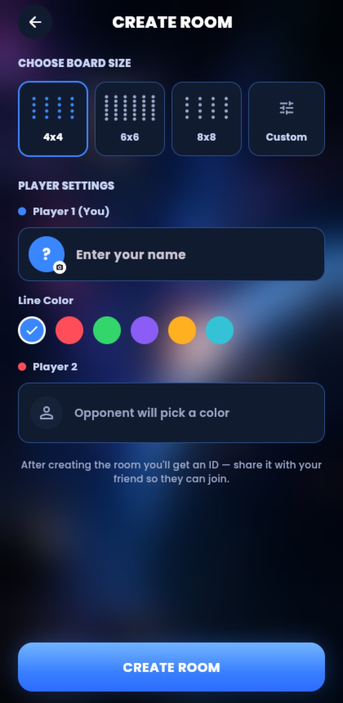

# Kare Kapmaca — Dots & Boxes

Klasik **Noktalar ve Kutular (Dots & Boxes)** oyununun Flutter ile yazılmış, Android, iOS ve web'de çalışan sürümü. Aynı cihazda iki kişi oynanabilir ya da oda kodu paylaşılarak Firestore üzerinden gerçek zamanlı çevrimiçi maç yapılabilir.

### ▶️ [Canlı demoyu oyna](https://ahmettulas.github.io/kare_kapmaca/)

<p align="center">
  
  &nbsp;
  
  &nbsp;
  
</p>

## Özellikler

- **Çevrimiçi oyun:** 6 haneli oda kodu ile eşleşme, hamleler Firestore üzerinden anlık senkronize edilir
- **Aynı cihazda oyun:** iki oyuncu sırayla, geri alma (undo) desteğiyle
- **Tahta boyutları:** 4x4, 6x6, 8x8 veya özel boyut
- **Kişiselleştirme:** oyuncu adı, avatar fotoğrafı, çizgi rengi, temalar (uzay, orman, ...)
- **Ses:** arka plan müziği ve efektler, ayarlardan açılıp kapatılabilir
- **Maç geçmişi:** oynanan maçlar (oyuncular, skor, tahta boyutu) cihazda saklanır
- **Çoklu dil:** Türkçe ve İngilizce

## Teknolojiler

| Alan | Kullanılan |
| --- | --- |
| Framework | Flutter (Dart) — Android, iOS, Web |
| State management | Provider (`ChangeNotifier`) |
| Backend | Firebase Cloud Firestore (gerçek zamanlı oda ve hamle senkronizasyonu) |
| Yerel depolama | shared_preferences |
| Ses | audioplayers |
| Reklam | Google Mobile Ads (yalnızca Android) |
| CI/CD | GitHub Actions → analiz, test, web build, GitHub Pages deploy |

## Proje yapısı

```
lib/
├── game_logic/   # Saf oyun motoru: kenarlar, kutu tamamlama, sıra, skor (UI'dan bağımsız)
├── models/       # Oda, hamle, oyuncu profili, tahta boyutu
├── services/     # Firestore oda servisi, ayarlar, istatistik, ses, reklam
├── screens/      # Menü, kurulum, oyun, bekleme odası, oyun sonu ...
├── widgets/      # Tahta çizimi (CustomPainter), butonlar, paneller
├── theme/        # Renk paletleri ve tema ön ayarları
└── l10n/         # Türkçe / İngilizce metinler
```

Oyun mantığı (`game_logic/`) arayüzden ayrı tutulduğu için doğrudan birim testleriyle test edilir.

## Çalıştırma

```bash
flutter pub get
flutter run -d chrome   # veya bağlı bir Android/iOS cihaz
```

Testler:

```bash
flutter test
```

## Dağıtım

`main` dalına yapılan her push'ta [GitHub Actions workflow'u](.github/workflows/deploy-web.yml) analiz ve testleri çalıştırır, web sürümünü derler ve GitHub Pages'e yayınlar.

## Notlar

- Uygulamada kullanıcı girişi yoktur; oda koduna sahip olan herkes o odaya katılabilir. Firestore kuralları ([firestore.rules](firestore.rules)) yazmaları yalnızca oyunun gerçekten yaptığı geçişlerle sınırlar: katılma, tek hamle ekleme ve oyunu bitirme.
- Tarayıcılar kullanıcı etkileşimi olmadan ses çalmaya izin vermediği için web'de müzik ilk dokunuşta başlar.
- Web demosunda reklam gösterilmez.
